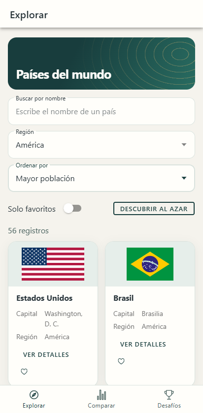
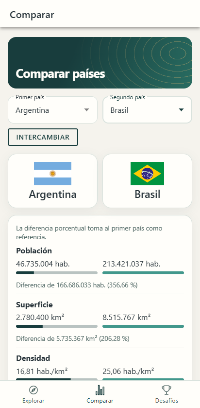
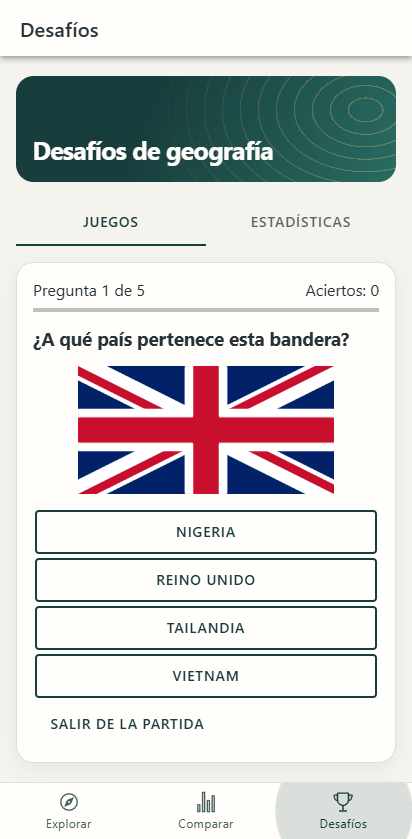
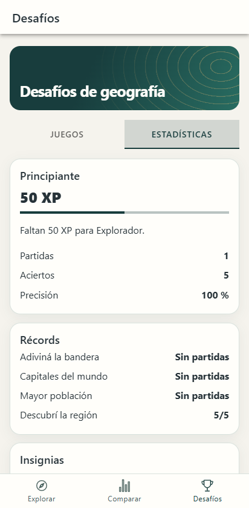

# GeoGo

GeoGo es una aplicación móvil educativa en español para explorar países, comparar sus datos geográficos y aprender con desafíos de cinco preguntas.

Desarrollado por [humiik](https://github.com/humiik).

## Funcionalidades

- **Explorar.** Buscá países por nombre, combiná filtros por región y favoritos, y ordená por nombre, población o superficie. Abrí una ficha para ver la bandera y los datos del país. «Descubrir al azar» elige un país de los resultados visibles.
- **Comparar.** Seleccioná dos países para ver sus capitales, regiones, idiomas y monedas, además de población, superficie y densidad. Las barras muestran la proporción respecto al valor mayor. El porcentaje de diferencia usa al primer país como referencia y se omite si ese valor es cero o falta.
- **Desafíos.** Jugá con banderas, capitales, población o regiones. Cada partida tiene cinco preguntas a partir del catálogo. Una partida completada suma 10 XP por acierto. La sección Estadísticas muestra el nivel, la precisión, los récords y las insignias.

Los favoritos y las partidas completadas se guardan en el almacenamiento local del navegador o WebView.

## Tecnologías y datos

Ionic Angular, Angular Standalone, TypeScript, SCSS, RxJS, HttpClient y Capacitor. El catálogo consulta la instancia pública v3.1 de REST Countries. Los nombres en español y los datos geográficos se normalizan en el servicio compartido. [Fuente de datos](https://restcountries.conventus.de/)

## Ejecución local

Desde la raíz del repositorio, entrá en la carpeta de la aplicación.

```bash
cd geogo
npm ci
npm start
```

El servidor local se abre en `http://localhost:4200`. La consulta del catálogo requiere conexión a Internet.

| Comando | Resultado |
| --- | --- |
| `npm run build` | Genera la compilación de producción en `geogo/www/` desde la raíz del repositorio. |
| `npm run test:unit` | Ejecuta las pruebas unitarias. |
| `npm run test:e2e` | Ejecuta las pruebas de navegador. Si Chromium aún no está disponible, instalalo con `npx playwright install chromium`. |

## Capturas

Capturas de la compilación de producción en una pantalla móvil emulada, con datos de la API real.

| Explorar | Comparar |
| --- | --- |
|  |  |

| Desafíos | Estadísticas |
| --- | --- |
|  |  |

El registro de asistencia con IA está en [IA.md](IA.md).
